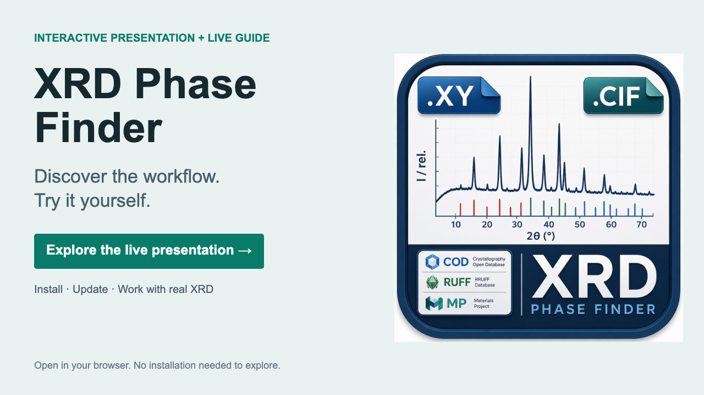
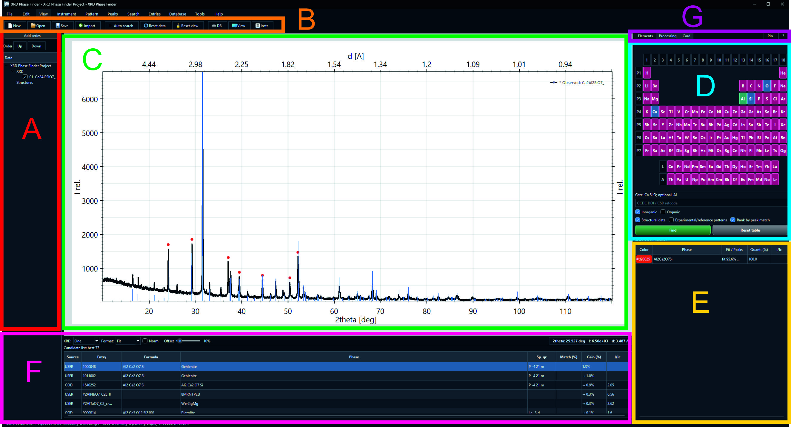

# XRD Phase Finder


**XRD Phase Finder** is a desktop program for interpreting powder X-ray diffraction patterns. It combines the experimental pattern, phase candidates, calculated profiles, selected phases and residual signal in one interface.

[](https://abkuznetsov.github.io/XRD_Analysis_Toolkit/)

**[Explore the interactive presentation and live guide →](https://abkuznetsov.github.io/XRD_Analysis_Toolkit/)**

The nine horizontal slides introduce capabilities, data sources, libraries, installation, updates and offline mode. Open the presentation in the expanded window, then follow the embedded Finder guide using a real CaWO4 measurement. Candidate scores and fitted curves in the tutorial are illustrative. The HTML presentation is exported with [SPICY SLIDES](https://abkuznetsov.github.io/SPICY/).

## Download

- [Windows installer (1.6.10): XRD_Phase_Finder_Setup_v1_6_10.exe](https://github.com/ABKuznetsov/XRD_Analysis_Toolkit/releases/download/v1.6.10/XRD_Phase_Finder_Setup_v1_6_10.exe)
- [macOS package (1.6.9): XRD_Phase_Finder_macOS_1.6.9.pkg](https://github.com/ABKuznetsov/XRD_Analysis_Toolkit/releases/download/v1.6.9/XRD_Phase_Finder_macOS_1.6.9.pkg)
- [Ubuntu / Debian package (1.6.9): XRD_Phase_Finder_1.6.9_amd64.deb](https://github.com/ABKuznetsov/XRD_Analysis_Toolkit/releases/download/v1.6.9/XRD_Phase_Finder_1.6.9_amd64.deb)

The [Windows 1.6.10 release](https://github.com/ABKuznetsov/XRD_Analysis_Toolkit/releases/tag/v1.6.10) is available now. macOS and Linux packages remain at 1.6.9; their direct download links are listed above.

## Main window



The project tree (A) contains imported patterns and structures. The toolbar (B) provides the main file and analysis actions. The plot (C) shows experimental and calculated patterns. The element panel (D) controls the search composition. Selected phases appear in table (E), candidates in table (F), and the active card details in panel (G).

## Main features

- use contextual Help, guided workflows and a separate training example;
- import XRD patterns and CIF files;
- search user libraries and configured crystallographic databases;
- filter candidates with the periodic table;
- compare experimental and calculated diffraction patterns;
- inspect Match, Gain, residual signal and unexplained peaks;
- adjust smoothing, background and amorphous contribution;
- select phases and compare their combined calculated profile;
- copy diffraction-table cells, columns or the complete table;
- save and reopen `.xpff` projects;
- export and import settings, instrument profiles and local caches.

## Install and run

### Windows

Download and run `XRD_Phase_Finder_Setup_v1_6_10.exe`. The installer creates Start Menu and Desktop shortcuts and registers `.xpff` project files.

On first launch, the launcher checks the per-user scientific Python runtime and offers to install or repair missing packages. User projects, settings and database caches are stored in the user profile.

### Ubuntu / Debian Linux

Download `XRD_Phase_Finder_1.6.9_amd64.deb` from the [1.6.9 release](https://github.com/ABKuznetsov/XRD_Analysis_Toolkit/releases/tag/v1.6.9) and install it with your package manager. The application can also be started from source:

```bash
git clone https://github.com/ABKuznetsov/XRD_Analysis_Toolkit.git
cd XRD_Analysis_Toolkit
python3.12 -m venv .venv
. .venv/bin/activate
python -m pip install -U pip setuptools wheel
python -m pip install -r requirements.txt
python -m xrd_finder.apps.finder_gui
```

Python 3.11 can be used when Python 3.12 is unavailable. If Qt fails under Wayland, start an X11 session or run:

```bash
QT_QPA_PLATFORM=xcb python -m xrd_finder.apps.finder_gui
```

### macOS

Download and run the current `.pkg` from the release page. For a direct source run, install the dependencies and execute:

```bash
./run_finder.command
```

## Basic workflow

1. Open an experimental XRD pattern.
2. Set the radiation and instrument profile when needed.
3. Use the Processing tab to adjust smoothing, background, crop and amorphous contribution.
4. Select required or possible elements in the periodic table.
5. Click **Identify phases**, review the search settings and start the search. Use **Search database** for manual composition-based lookup.
6. Accept confirmed phases and review the residual signal and Gain suggestions.
7. Save the interpretation as an `.xpff` project.

Use the toolbar **Help** toggle for explanations of controls, **Help -> Learn Finder** for guided workflows, or **Help -> Open example project** for the bundled demonstration project.

## Prepare and transfer a local library

Open **Manage databases -> Download inorganic COD… -> Download and prepare SQL**. Finder downloads original CIF files from COD and prepares them in parallel. Separate progress bars show downloads and calculations, with estimated time remaining. Existing downloads and compatible prepared entries are reused; completed work remains available after cancellation.

Use **Manage databases -> Export prepared library…** to save a `.xpflib` archive. On another computer running a compatible Finder version, choose **Import prepared library…**. The archive transfers CIFs, calculated reflections and search indexes so compatible entries do not need recalculation. User libraries are stored separately from the application and are not bundled with the installer.

CCDC web search is temporarily disabled in 1.6.10. You can still import CIF files downloaded manually from CCDC.

## Offline use

The application has no telemetry. Prepared user CIF libraries, local indexes and cached database records remain available without a network connection. Select **Tools -> Network mode -> Offline / secure** to disable online searches and update checks.

See [SECURITY.md](SECURITY.md) for controlled-network deployment notes.

## Run from source on Windows

Install Python 3.11 or 3.12 and the dependencies from `requirements.txt`, then run:

```bat
run_finder.bat
```

Command-line entry points are also provided as `run_finder_cli.bat`, `run_finder_cli.sh` and `run_finder_cli.command`.

The CLI uses the built-in Cu K-alpha instrument profile by default:

```bash
python -m xrd_finder.apps.finder_cli pattern.txt --cif phase.cif --output result.json
```

Use `--wavelength 0.7093` for a monochromatic wavelength in angstroms, or `--instrument-profile instrument.json` for a calibrated profile saved with the instrument dialog's **Export** button. These two options are mutually exclusive. Supply each additional structure with another `--cif` option.

## License

MIT. See [LICENSE](LICENSE).
